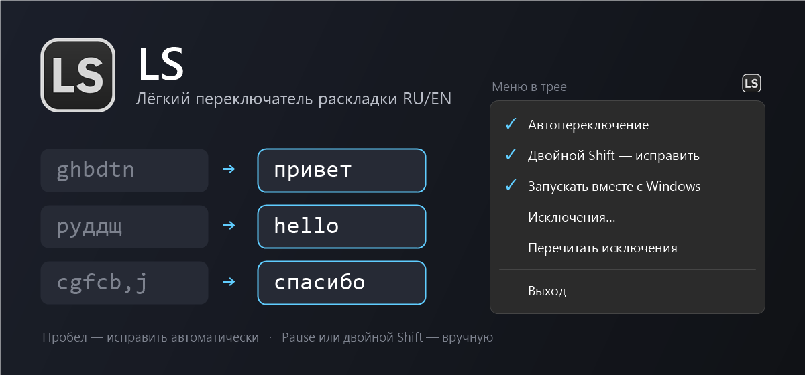

# LS

Лёгкий переключатель раскладки RU/EN для Windows — аналог Punto Switcher в одном скрипте AutoHotkey.

Набрали `ghbdtn` вместо «привет» — LS заметит это по пробелу, перепечатает слово и переключит раскладку. Если не заметил, исправьте вручную двойным `Shift`. Один файл на 25 КБ, без установки, без словарей и без отправки данных куда-либо.

## Установка

1. Установите [AutoHotkey v2](https://www.autohotkey.com).
2. Скачайте `LS.ahk` и `LS.ico` в одну папку (кнопка **Code → Download ZIP**).
3. Дважды щёлкните по `LS.ahk` — у часов появится значок «LS».

## Как пользоваться

- **Автоисправление.** Набрали слово не в той раскладке и нажали пробел — слово заменяется, раскладка переключается (`ghbdtn` → `привет`, `руддщ` → `hello`).
- **Вручную.** `Pause` или двойной `Shift` исправляет последнее слово; повторное нажатие возвращает обратно.
- **Выделенный текст.** `Shift+Pause`, либо двойной `Shift`, когда только что набранного слова нет.
- **Обучение.** Отмените ошибочную автозамену двойным `Shift` — слово попадёт в `exceptions.txt` и больше не будет исправляться.
- **Меню в трее.** Автопереключение, двойной Shift, автозапуск с Windows, исключения, выход.

## Особенности

- Словаря нет: слово оценивается по правилам русского и английского и по спискам частых слов, поэтому возможны пропуски и ложные срабатывания.
- В терминалах автопереключение выключено. Другие программы можно исключить строкой `@имя_процесса` в `exceptions.txt`.
- Нажатия хранятся только в памяти и только для текущего слова; скрипт ничего не записывает и никуда не отправляет.
