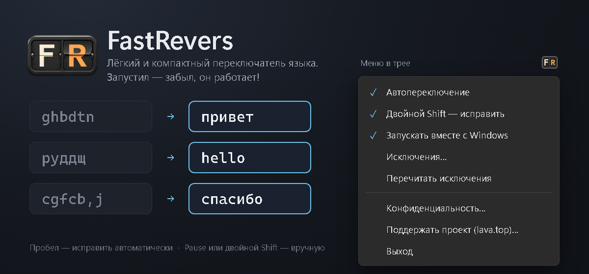
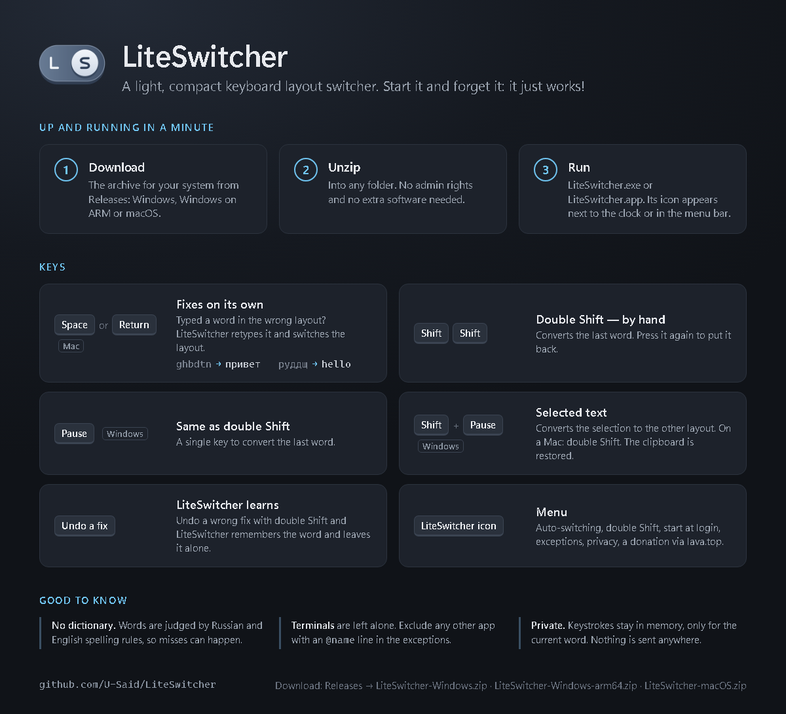

# FastRevers

**Русский** · [English](#english)

**FastRevers™** — лёгкий переключатель раскладки RU/EN для Windows и macOS, альтернатива Punto Switcher. Одна маленькая программа без установки: скачали, распаковали, запустили.

> **LiteSwitcher теперь FastRevers.** С версии 2.2 программа называется FastRevers (до 2.1 — LS, в 2.1 — LiteSwitcher), а репозиторий переехал сюда с адреса github.com/U-Said/LiteSwitcher; старые ссылки ведут сюда же. Настройки, исключения и автозапуск прежней версии FastRevers переносит сам.
> **Осторожно:** файлы LiteSwitcher.exe из других репозиториев GitHub к этой программе отношения не имеют, VirusTotal определяет их как троян. Не скачивайте и не запускайте их.



Набрали `ghbdtn` вместо «привет» — FastRevers заметит это по пробелу, перепечатает слово и переключит раскладку. Если не заметил, исправьте вручную двойным `Shift`. Без словарей и без отправки данных куда-либо.

**Нравится FastRevers? [Поддержите проект донатом](https://app.lava.top/4179967925)** ([подробнее](#поддержать-проект))

## Скачать

| Система | Файл |
|---|---|
| **Windows 10/11** на Intel или AMD (x64) | [FastRevers-Windows.zip](https://github.com/U-Said/FastRevers/releases/latest/download/FastRevers-Windows.zip) |
| **Windows 11 на ARM**: Snapdragon (Surface Pro 11/12 и др.) | [FastRevers-Windows-arm64.zip](https://github.com/U-Said/FastRevers/releases/latest/download/FastRevers-Windows-arm64.zip) |
| **macOS 11+**, Apple Silicon и Intel | [FastRevers-macOS.zip](https://github.com/U-Said/FastRevers/releases/latest/download/FastRevers-macOS.zip) |

Ничего дополнительно ставить не нужно: ни AutoHotkey, ни Hammerspoon, ни библиотек.

**Официальные сборки — только на странице [Releases](https://github.com/U-Said/FastRevers/releases) этого репозитория.** Не скачивайте FastRevers с других сайтов и из чужих репозиториев. Контрольные суммы SHA-256 каждого выпуска лежат в файле `SHA256SUMS.txt` рядом с архивами. Проверить архив в Windows: `Get-FileHash FastRevers-Windows.zip` в PowerShell, на Mac: `shasum -a 256 FastRevers-macOS.zip`.

[Конфиденциальность](PRIVACY.md) · [Политика подписи кода](CODE_SIGNING.md) · [Безопасность](SECURITY.md) · [Удаление](#удаление)

## Коротко


## Windows

### Запуск

1. Скачайте архив для своего процессора и распакуйте в папку, которая не синхронизируется с облаком, например `%LOCALAPPDATA%\Programs\FastRevers` (вставьте этот путь в адресную строку Проводника).
2. Запустите `FastRevers.exe`. Если Windows покажет «Система Windows защитила ваш компьютер», нажмите **Подробнее → Выполнить в любом случае**: программа не подписана платным сертификатом.
3. У часов появится значок FastRevers. Чтобы программа запускалась сама, включите в меню значка **Запускать вместе с Windows**.

Настройки (`FastRevers.ini`) и исключения (`exceptions.txt`) лежат рядом с `FastRevers.exe`, так что папку можно переносить целиком. Если в эту папку нельзя писать, они хранятся в `%APPDATA%\FastRevers`. Права администратора не нужны.

**Обновление.** Значок FastRevers → **Выход**, замените `FastRevers.exe` новым и запустите.

**Переход с LiteSwitcher или LS.** Положите `FastRevers.exe` в папку, где лежит `LiteSwitcher.exe` (или `LS.exe`), и запустите. FastRevers сам закроет старую версию и заберёт её настройки, исключения и автозапуск, если он был включён (выключенный в «Параметрах» останется выключенным), и сообщит об этом. После этого старый файл можно удалить.

**Переход с версии на AutoHotkey.** Положите `FastRevers.exe` в ту же папку, где был `LS.ahk`: исключения подхватятся. Старый скрипт и его автозапуск FastRevers сам не трогает: если LS.ahk ещё запущен или остался в автозагрузке, программа подскажет, как его закрыть и убрать. Автозапуск FastRevers включите в его меню.

### Как пользоваться

- **Автоисправление.** Набрали слово не в той раскладке и нажали пробел — слово заменяется, раскладка переключается (`ghbdtn` → `привет`, `руддщ` → `hello`).
- **Вручную.** `Pause` или двойной `Shift` исправляет последнее слово; повторное нажатие возвращает обратно.
- **Выделенный текст.** `Shift+Pause`, либо двойной `Shift`, когда только что набранного слова нет. Буфер обмена потом возвращается как был.
- **Обучение.** Отмените ошибочную автозамену двойным `Shift` — слово попадёт в `exceptions.txt` и больше не будет исправляться.
- **Меню в трее.** Автопереключение, двойной Shift, автозапуск с Windows, исключения, «Конфиденциальность…», «Поддержать проект (lava.top)…», выход.

## macOS

> Версия для macOS собирается и проходит автоматические проверки на Mac (раскладки, распознавание слов), но вживую на Mac ещё не испытана. Если что-то работает не так — напишите в [Issues](https://github.com/U-Said/FastRevers/issues).

### Запуск

1. Скачайте `FastRevers-macOS.zip`, распакуйте и перетащите **FastRevers.app** в папку **Программы**.
2. Откройте FastRevers. Приложение не заверено Apple, поэтому при первом запуске macOS его остановит. Откройте **Системные настройки → Конфиденциальность и безопасность** и внизу нажмите **Всё равно открыть**. В macOS 14 и старше можно проще: правый щелчок по FastRevers.app → **Открыть**.
3. Разрешите FastRevers управлять компьютером: **Конфиденциальность и безопасность → Универсальный доступ** → включите FastRevers. Через пару секунд значок в строке меню станет ярким — можно печатать.
4. Проверьте, что в системе есть две раскладки: английская (**ABC** или **США**) и **Русская** или **Русская — ПК**.
5. Чтобы FastRevers запускался сам, включите в его меню **Запускать при входе в систему**.

После обновления macOS может перестать считать FastRevers доверенным. Тогда удалите его из **Универсального доступа** кнопкой «−» и включите снова.

**Переход с LiteSwitcher или LS.** Перетащите FastRevers.app в «Программы» и откройте: он сам закроет старую версию и заберёт её настройки, исключения и запуск при входе, если он был включён. Затем удалите LiteSwitcher.app (или LS.app) в Корзину, а её строку в **Универсальном доступе** — кнопкой «−», и включите там FastRevers.

**Переход с версии для Hammerspoon.** Уберите строку `require("LS")` из `~/.hammerspoon/init.lua` и выберите в Hammerspoon **Reload Config**. Выученные исключения перенесутся сами.

### Как пользоваться

- **Автоисправление.** Набрали слово не в той раскладке и нажали пробел или Return — слово заменяется, раскладка переключается.
- **Вручную.** Двойной `Shift` исправляет последнее слово; повторное нажатие возвращает обратно.
- **Выделенный текст.** Двойной `Shift`, когда только что набранного слова нет.
- **Обучение.** Отмените ошибочную автозамену двойным `Shift` — слово попадёт в исключения (`~/Library/Application Support/FastRevers/exceptions.txt`).
- **Меню в строке меню.** Автопереключение, двойной Shift, запуск при входе, исключения, «Конфиденциальность…», «Поддержать проект (lava.top)…», выход. Язык меню — как у системы.

## Особенности

- Словаря нет: слово оценивается по правилам русского и английского и по спискам частых слов, поэтому возможны пропуски и ложные срабатывания.
- В терминалах автопереключение выключено. Другие программы можно исключить строкой `@имя_программы` в файле исключений.
- В полях паролей macOS сама скрывает нажатия от FastRevers. В Windows FastRevers не трогает классические поля паролей; поле пароля в браузере он не распознаёт, но слово исправляется только после пробела, а в паролях пробелов обычно нет.
- Нажатия хранятся только в памяти и только для текущего слова. На диск FastRevers записывает только своё: настройки (в Windows — `FastRevers.ini`, на Mac — настройки программы в системе), файл исключений `exceptions.txt`, куда обычным текстом попадают слова, для которых вы отменили исправление, и запись автозапуска, если он включён. В сеть программа ничего не отправляет: сетевого кода в ней нет, браузер открывается только пунктами «Конфиденциальность…» и «Поддержать проект (lava.top)…». Чтобы исправить выделенный текст, FastRevers копирует его через буфер обмена, как Ctrl+C, а потом возвращает прежнее содержимое. Если в Windows включён журнал буфера обмена (Win+V) или его синхронизация, скопированный фрагмент может туда попасть (на Mac — в менеджеры буфера обмена). Исправленный текст FastRevers помечает, чтобы он туда не попадал. Подробно — в [PRIVACY.md](PRIVACY.md).

## Удаление

**Windows**

1. В меню значка снимите **Запускать вместе с Windows** и выберите **Выход**.
2. Удалите папку с `FastRevers.exe` — там же лежат `FastRevers.ini` и `exceptions.txt`.
3. Если есть папка `%APPDATA%\FastRevers`, удалите и её.
4. Если программу уже удалили, не выключив автозапуск, уберите его в **Параметры → Приложения → Автозагрузка** или командами ниже. Сообщение, что раздел или параметр не найден, значит, что записи уже нет.

```
reg delete "HKCU\Software\Microsoft\Windows\CurrentVersion\Run" /v FastRevers /f
reg delete "HKCU\Software\Microsoft\Windows\CurrentVersion\Explorer\StartupApproved\Run" /v FastRevers /f
```

**macOS**

1. В меню FastRevers снимите **Запускать при входе в систему** и выберите **Выйти из FastRevers**.
2. Перетащите FastRevers.app в Корзину.
3. Удалите папку `~/Library/Application Support/FastRevers` и, если остался, файл `~/Library/LaunchAgents/io.github.u-said.ls.plist`.
4. Удалите настройки командой `defaults delete io.github.u-said.ls` в Терминале.
5. Уберите FastRevers из **Конфиденциальность и безопасность → Универсальный доступ** кнопкой «−» или командой `tccutil reset Accessibility io.github.u-said.ls`.

## Поддержать проект

FastRevers бесплатный, без рекламы и с открытым кодом. Если программа вам пригодилась, можно сказать спасибо донатом:
**https://app.lava.top/4179967925** → кнопка «Отправить донат». Эту же страницу открывает пункт меню «Поддержать проект (lava.top)…».

- Сумму, валюту и способ оплаты вы выбираете на странице lava.top; что доступно, зависит от страны и банка.
- Платёж принимает платформа lava.top (LAVALANE LTD, Кипр) по своим условиям: https://lava.top/docs/terms (юридическую силу имеет английская версия).
- Донат добровольный, ничего не открывает в программе и не возвращается.

## Сборка из исходников

- **Windows** (Visual Studio 2022 с C++): `cmake -S . -B build -A x64` (или `-A ARM64`), затем `cmake --build build --config Release`. Проверки: `build\Release\FastRevers.exe --selftest report.txt` и `tools\e2e_windows.ps1`.
- **macOS** (Xcode Command Line Tools): `bash macos/build.sh`, проверка: `build/macos/FastRevers.app/Contents/MacOS/FastRevers --selftest`.
- Логика распознавания общая для обеих систем: `core/ls_core.c`. Прежние версии-скрипты лежат в `legacy/`.

## Политика подписи кода (Code signing policy)

Как собираются выпуски, кто вносит и проверяет изменения и кто утверждает подпись — в [CODE_SIGNING.md](CODE_SIGNING.md).

## Названия

Punto Switcher — продукт компании «Яндекс», Caramba Switcher — продукт своего правообладателя; названия принадлежат их владельцам. FastRevers с ними не связан.

---

## English

**FastRevers™** is a lightweight RU/EN keyboard layout switcher for Windows and macOS, a Punto Switcher alternative. One small app, no installer: download, unzip, run.

> **LiteSwitcher is now FastRevers.** Since version 2.2 the app is called FastRevers (it was LS up to 2.1 and LiteSwitcher in 2.1), and this repository moved here from github.com/U-Said/LiteSwitcher; old links lead here. FastRevers takes over the settings, exceptions and autostart of the earlier version by itself.
> **Beware:** LiteSwitcher.exe files in other GitHub repositories have nothing to do with this app, and VirusTotal detects them as a trojan. Do not download or run them.


Typed `ghbdtn` when you meant «привет»? FastRevers notices it when you press Space, retypes the word and switches the layout. If it misses one, fix it yourself with a double `Shift`. No dictionaries, and nothing is sent anywhere.

**Like FastRevers? [Support the project with a donation](https://app.lava.top/4179967925)** ([details](#support-the-project))

## Download

| System | File |
|---|---|
| **Windows 10/11** on Intel or AMD (x64) | [FastRevers-Windows.zip](https://github.com/U-Said/FastRevers/releases/latest/download/FastRevers-Windows.zip) |
| **Windows 11 on ARM**: Snapdragon (Surface Pro 11/12 etc.) | [FastRevers-Windows-arm64.zip](https://github.com/U-Said/FastRevers/releases/latest/download/FastRevers-Windows-arm64.zip) |
| **macOS 11+**, Apple Silicon and Intel | [FastRevers-macOS.zip](https://github.com/U-Said/FastRevers/releases/latest/download/FastRevers-macOS.zip) |

Nothing else to install: no AutoHotkey, no Hammerspoon, no libraries.

**Official builds are published only on this repository's [Releases](https://github.com/U-Said/FastRevers/releases) page.** Do not download FastRevers from other sites or other repositories. The SHA-256 checksums of every release are in `SHA256SUMS.txt` next to the archives. To check an archive on Windows: `Get-FileHash FastRevers-Windows.zip` in PowerShell; on a Mac: `shasum -a 256 FastRevers-macOS.zip`.

[Privacy](PRIVACY.md#privacy-policy) · [Code signing policy](CODE_SIGNING.md) · [Security](SECURITY.md#security-policy) · [Uninstall](#uninstall)

## At a glance



## Windows (English)

1. Unzip the archive for your CPU into a folder that is not synced to the cloud, for example `%LOCALAPPDATA%\Programs\FastRevers` (paste this path into the File Explorer address bar), and run `FastRevers.exe`. If Windows says “Windows protected your PC”, click **More info → Run anyway**: the app is not signed with a paid certificate.
2. The FastRevers icon appears next to the clock. To start it automatically, tick **Start with Windows** in its menu.
3. Settings (`FastRevers.ini`) and exceptions (`exceptions.txt`) are kept next to `FastRevers.exe`, or in `%APPDATA%\FastRevers` if that folder is read-only. No admin rights needed.

**Usage.** Space fixes a word typed in the wrong layout. `Pause` or a double `Shift` converts the last word (press again to undo). `Shift+Pause`, or a double `Shift` with no fresh word, converts the selected text; the clipboard is restored afterwards. Undoing a wrong auto-fix adds the word to `exceptions.txt`. The tray menu: auto-switching, double Shift, start with Windows, exceptions, “Privacy…”, “Support the project (lava.top)…”, exit.

**Coming from LiteSwitcher or LS?** Put `FastRevers.exe` into the folder with `LiteSwitcher.exe` (or `LS.exe`) and run it. FastRevers closes the old version, takes over its settings, exceptions and autostart if it was on (if it was turned off in Settings, it stays off), and tells you so. You can delete the old file afterwards.

**Coming from the AutoHotkey version?** Put `FastRevers.exe` into the folder with `LS.ahk`: your exceptions are kept. FastRevers does not touch the old script or its autostart itself: if LS.ahk is still running or still in Startup, it tells you how to close and remove it. Turn on FastRevers's own autostart in its menu.

## macOS (English)

> The macOS version is built and passes automated checks on a Mac (layouts, word detection), but has not been tried by hand on a real Mac yet. If something misbehaves, please open an [issue](https://github.com/U-Said/FastRevers/issues).

1. Unzip `FastRevers-macOS.zip` and drag **FastRevers.app** to **Applications**.
2. Open FastRevers. It is not notarized, so macOS blocks the first launch: open **System Settings → Privacy & Security** and click **Open Anyway** at the bottom (on macOS 14 and older: right-click FastRevers.app → **Open**).
3. Allow FastRevers in **Privacy & Security → Accessibility**. A few seconds later its icon in the menu bar turns solid and FastRevers is working.
4. You need two input sources: an English one (**ABC** or **U.S.**) and **Russian** or **Russian – PC**.
5. To start FastRevers automatically, tick **Open at login** in its menu.

After an update macOS may stop trusting FastRevers: remove it from **Accessibility** with “−” and enable it again.

**Coming from LiteSwitcher or LS?** Drag FastRevers.app to Applications and open it: it closes the old version and takes over its settings, exceptions and login item if it was on. Then move LiteSwitcher.app (or LS.app) to the Trash, remove it from **Accessibility** with “−” and enable FastRevers there.

**Usage.** Space or Return fixes a word typed in the wrong layout. A double `Shift` converts the last word (press again to undo), or the selected text when there is no fresh word. Undoing a wrong auto-fix adds the word to `~/Library/Application Support/FastRevers/exceptions.txt`.

**Coming from the Hammerspoon version?** Remove `require("LS")` from `~/.hammerspoon/init.lua` and choose **Reload Config**. Learned exceptions are moved over automatically.

## Notes

- There is no dictionary: each word is judged by Russian and English spelling rules and lists of common words, so misses and false positives are possible.
- Auto-switching is off in terminals. Exclude other apps with an `@app_name` line in the exceptions file.
- macOS hides keystrokes in password fields from FastRevers. On Windows FastRevers skips classic password boxes; it cannot detect password fields in browsers, but a word is only fixed after Space, and passwords rarely contain spaces.
- Keystrokes are kept in memory only, for the current word. On disk FastRevers writes only its own data: settings (`FastRevers.ini` on Windows, the app's preferences on a Mac), the exceptions file `exceptions.txt`, where words whose fix you undid are added as plain text, and the start-at-login entry if you turn it on. It sends nothing over the network: there is no network code, and a browser opens only from “Privacy…” and “Support the project (lava.top)…”. To convert selected text FastRevers copies it via the clipboard, like Ctrl+C, and then restores the previous contents. If Windows clipboard history (Win+V) or its sync is on, the copied fragment may be saved there (on a Mac, in clipboard managers); the converted text is marked so that it is not. Details: [PRIVACY.md](PRIVACY.md#privacy-policy).

## Uninstall

**Windows**

1. Untick **Start with Windows** in the icon's menu and choose **Exit**.
2. Delete the folder with `FastRevers.exe`; `FastRevers.ini` and `exceptions.txt` are there too.
3. If there is a `%APPDATA%\FastRevers` folder, delete it as well.
4. If you already deleted the app with autostart on, remove it in **Settings → Apps → Startup** or with the commands below. A “not found” message means the entry is already gone.

```
reg delete "HKCU\Software\Microsoft\Windows\CurrentVersion\Run" /v FastRevers /f
reg delete "HKCU\Software\Microsoft\Windows\CurrentVersion\Explorer\StartupApproved\Run" /v FastRevers /f
```

**macOS**

1. Untick **Open at login** in the FastRevers menu and choose **Quit FastRevers**.
2. Move FastRevers.app to the Trash.
3. Delete `~/Library/Application Support/FastRevers` and, if it is still there, `~/Library/LaunchAgents/io.github.u-said.ls.plist`.
4. Delete the settings with `defaults delete io.github.u-said.ls` in Terminal.
5. Remove FastRevers from **Privacy & Security → Accessibility** with “−”, or run `tccutil reset Accessibility io.github.u-said.ls`.

## Support the project

FastRevers is free, ad-free and open source. If it is useful to you, you can say thanks with a donation:
**https://app.lava.top/4179967925** → the «Отправить донат» (Send a donation) button. The menu item “Support the project (lava.top)…” opens the same page.

- You choose the amount, currency and payment method on the lava.top page; what is available depends on your country and bank.
- The payment is accepted by the lava.top platform (LAVALANE LTD, Cyprus) under its terms: https://lava.top/docs/terms (the English version prevails).
- The donation is voluntary, unlocks nothing in the app and is non-refundable.

## Building

- **Windows** (Visual Studio 2022 with C++): `cmake -S . -B build -A x64` (or `-A ARM64`), then `cmake --build build --config Release`.
- **macOS** (Xcode Command Line Tools): `bash macos/build.sh`.
- The detector is shared by both apps: `core/ls_core.c`. The old script versions are in `legacy/`.

## Code signing policy

How releases are built, who commits and reviews changes and who approves signing: [CODE_SIGNING.md](CODE_SIGNING.md).

## Trademarks

Punto Switcher is a product of Yandex, Caramba Switcher belongs to its respective owner; all names are the property of their owners. FastRevers is not affiliated with them.

## License

[MIT](LICENSE). Copyright (c) 2026 U-Said.
