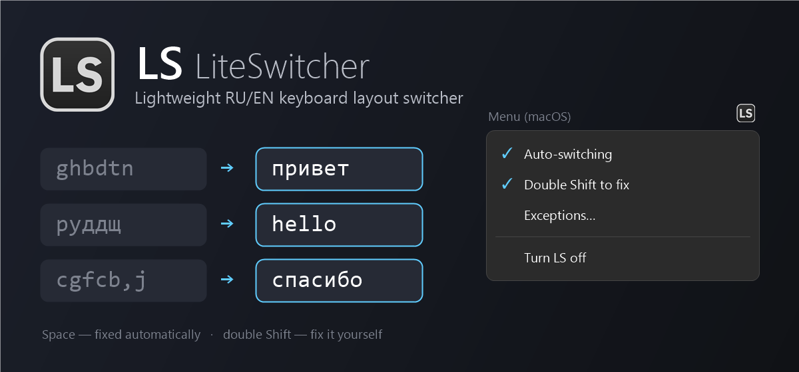

# LS — LiteSwitcher

**Русский** · [English](#english)

**LS (LiteSwitcher)** — лёгкий переключатель раскладки RU/EN для Windows и macOS, аналог Punto Switcher в одном скрипте.


Набрали `ghbdtn` вместо «привет» — LS заметит это по пробелу, перепечатает слово и переключит раскладку. Если не заметил, исправьте вручную двойным `Shift`. Один небольшой файл, без установщика, без словарей и без отправки данных куда-либо.

## Скачать

| Система | Файлы | Что нужно установить |
|---|---|---|
| **Windows** | [LS.ahk](https://github.com/U-Said/LS/raw/main/LS.ahk) и [LS.ico](https://github.com/U-Said/LS/raw/main/LS.ico) | [AutoHotkey v2](https://www.autohotkey.com) |
| **macOS** | [LS.lua](https://github.com/U-Said/LS/raw/main/macos/LS.lua) | [Hammerspoon](https://www.hammerspoon.org) |

Всё сразу одним архивом: **Code → Download ZIP**.

## Windows

### Запуск

1. Установите [AutoHotkey v2](https://www.autohotkey.com).
2. Скачайте `LS.ahk` и `LS.ico` в одну папку.
3. Дважды щёлкните по `LS.ahk` — у часов появится значок «LS».
4. Чтобы LS запускался сам, включите в меню значка «Запускать вместе с Windows».

### Как пользоваться

- **Автоисправление.** Набрали слово не в той раскладке и нажали пробел — слово заменяется, раскладка переключается (`ghbdtn` → `привет`, `руддщ` → `hello`).
- **Вручную.** `Pause` или двойной `Shift` исправляет последнее слово; повторное нажатие возвращает обратно.
- **Выделенный текст.** `Shift+Pause`, либо двойной `Shift`, когда только что набранного слова нет.
- **Обучение.** Отмените ошибочную автозамену двойным `Shift` — слово попадёт в `exceptions.txt` и больше не будет исправляться.
- **Меню в трее.** Автопереключение, двойной Shift, автозапуск с Windows, исключения, выход.

## macOS

> Версия для macOS написана по той же логике, но пока не проверена на реальном Mac. Если что-то работает не так — напишите в [Issues](https://github.com/U-Said/LS/issues).

### Запуск

1. Установите [Hammerspoon](https://www.hammerspoon.org) и запустите его.
2. Разрешите ему управлять компьютером: **Системные настройки → Конфиденциальность и безопасность → Универсальный доступ** → включите Hammerspoon.
3. Проверьте, что в системе есть две раскладки: английская (**ABC** или **U.S.**) и **Русская** или **Русская — ПК**.
4. Скачайте `LS.lua` и положите его в папку `~/.hammerspoon/`. Открыть её в Finder: `Cmd+Shift+G` и ввести `~/.hammerspoon`.
5. Откройте файл настроек: значок Hammerspoon в строке меню → **Open Config**. Добавьте в `init.lua` строку:

   ```lua
   require("LS")
   ```

6. Значок Hammerspoon → **Reload Config**. В строке меню появится «LS».
7. Чтобы LS запускался сам, включите в настройках Hammerspoon **Launch Hammerspoon at login**.

### Как пользоваться

- **Автоисправление.** Набрали слово не в той раскладке и нажали пробел или Return — слово заменяется, раскладка переключается.
- **Вручную.** Двойной `Shift` исправляет последнее слово; повторное нажатие возвращает обратно.
- **Выделенный текст.** Двойной `Shift`, когда только что набранного слова нет.
- **Обучение.** Отмените ошибочную автозамену двойным `Shift` — слово попадёт в `~/.hammerspoon/LS_exceptions.txt`.
- **Меню «LS» в строке меню.** Автопереключение, двойной Shift, исключения, выключение.

## Особенности

- Словаря нет: слово оценивается по правилам русского и английского и по спискам частых слов, поэтому возможны пропуски и ложные срабатывания.
- В терминалах автопереключение выключено. Другие программы можно исключить строкой `@имя_программы` в файле исключений.
- Нажатия хранятся только в памяти и только для текущего слова; скрипт ничего не записывает и никуда не отправляет.

---

## English

**LS (LiteSwitcher)** is a lightweight RU/EN keyboard layout switcher for Windows and macOS — a Punto Switcher alternative in a single script.



Typed `ghbdtn` when you meant «привет»? LS notices it when you press Space, retypes the word and switches the layout. If it misses one, fix it yourself with a double `Shift`. One small file, no installer, no dictionaries, and nothing is sent anywhere.

## Download

| System | Files | What to install |
|---|---|---|
| **Windows** | [LS.ahk](https://github.com/U-Said/LS/raw/main/LS.ahk) and [LS.ico](https://github.com/U-Said/LS/raw/main/LS.ico) | [AutoHotkey v2](https://www.autohotkey.com) |
| **macOS** | [LS.lua](https://github.com/U-Said/LS/raw/main/macos/LS.lua) | [Hammerspoon](https://www.hammerspoon.org) |

Everything in one archive: **Code → Download ZIP**.

## Windows (English)

### Getting started

1. Install [AutoHotkey v2](https://www.autohotkey.com).
2. Download `LS.ahk` and `LS.ico` into the same folder.
3. Double-click `LS.ahk` — the “LS” icon appears in the system tray.
4. To start LS automatically, tick “Запускать вместе с Windows” (start with Windows) in the tray menu. The Windows menu is in Russian.

### Usage

- **Auto-fix.** Type a word in the wrong layout and press Space — the word is replaced and the layout is switched (`ghbdtn` → `привет`, `руддщ` → `hello`).
- **Manual fix.** `Pause` or a double `Shift` converts the last word; press again to revert.
- **Selected text.** `Shift+Pause`, or a double `Shift` when there is no freshly typed word.
- **Learning.** Undo a wrong auto-fix with a double `Shift` — the word is added to `exceptions.txt` and will not be touched again.
- **Tray menu.** Auto-switching, double Shift, start with Windows, exceptions, exit.

## macOS (English)

> The macOS version follows the same logic but has not been tested on a real Mac yet. If something misbehaves, please open an [issue](https://github.com/U-Said/LS/issues).

### Getting started

1. Install [Hammerspoon](https://www.hammerspoon.org) and launch it.
2. Let it control your computer: **System Settings → Privacy & Security → Accessibility** → enable Hammerspoon.
3. Make sure you have two input sources: an English one (**ABC** or **U.S.**) and **Russian** or **Russian – PC**.
4. Download `LS.lua` and put it into `~/.hammerspoon/`. To open that folder in Finder, press `Cmd+Shift+G` and type `~/.hammerspoon`.
5. Open the config: Hammerspoon menu bar icon → **Open Config**. Add this line to `init.lua`:

   ```lua
   require("LS")
   ```

6. Hammerspoon icon → **Reload Config**. “LS” appears in the menu bar.
7. To start LS automatically, enable **Launch Hammerspoon at login** in Hammerspoon preferences.

### Usage

- **Auto-fix.** Type a word in the wrong layout and press Space or Return — the word is replaced and the layout is switched.
- **Manual fix.** A double `Shift` converts the last word; press again to revert.
- **Selected text.** A double `Shift` when there is no freshly typed word.
- **Learning.** Undo a wrong auto-fix with a double `Shift` — the word is added to `~/.hammerspoon/LS_exceptions.txt`.
- **“LS” menu in the menu bar.** Auto-switching, double Shift, exceptions, turn off. The menu follows the system language.

## Notes

- There is no dictionary: each word is judged by Russian and English spelling rules and lists of common words, so misses and false positives are possible.
- Auto-switching is off in terminals. Exclude other apps with an `@app_name` line in the exceptions file.
- Keystrokes are kept in memory only, and only for the current word; the script logs nothing and sends nothing.

## License

[MIT](LICENSE)
