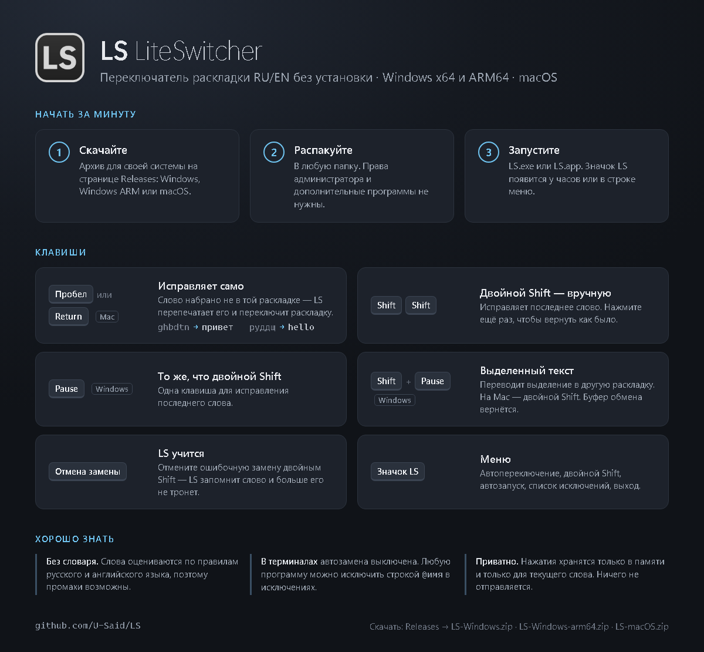

# LiteSwitcher

**Русский** · [English](#english)

**LiteSwitcher** — лёгкий переключатель раскладки RU/EN для Windows и macOS, аналог Punto Switcher. Одна маленькая программа без установки: скачали, распаковали, запустили.

Набрали `ghbdtn` вместо «привет» — LiteSwitcher заметит это по пробелу, перепечатает слово и переключит раскладку. Если не заметил, исправьте вручную двойным `Shift`. Без словарей и без отправки данных куда-либо.

**Нравится LiteSwitcher? [Поддержите проект донатом](https://app.lava.top/4179967925)** ([подробнее](#поддержать-проект))

## Скачать

| Система | Файл |
|---|---|
| **Windows 10/11** на Intel или AMD (x64) | [LiteSwitcher-Windows.zip](https://github.com/U-Said/LiteSwitcher/releases/latest/download/LiteSwitcher-Windows.zip) |
| **Windows 11 на ARM**: Snapdragon (Surface Pro 11/12 и др.) | [LiteSwitcher-Windows-arm64.zip](https://github.com/U-Said/LiteSwitcher/releases/latest/download/LiteSwitcher-Windows-arm64.zip) |
| **macOS 11+**, Apple Silicon и Intel | [LiteSwitcher-macOS.zip](https://github.com/U-Said/LiteSwitcher/releases/latest/download/LiteSwitcher-macOS.zip) |

Ничего дополнительно ставить не нужно: ни AutoHotkey, ни Hammerspoon, ни библиотек.

## Коротко

## Windows

### Запуск

1. Скачайте архив для своего процессора и распакуйте в любую папку, например `Документы\LiteSwitcher`.
2. Запустите `LiteSwitcher.exe`. Если Windows покажет «Система Windows защитила ваш компьютер», нажмите **Подробнее → Выполнить в любом случае**: программа не подписана платным сертификатом.
3. У часов появится значок LiteSwitcher. Чтобы программа запускалась сама, включите в меню значка **Запускать вместе с Windows**.

Настройки (`LiteSwitcher.ini`) и исключения (`exceptions.txt`) лежат рядом с `LiteSwitcher.exe`, так что папку можно переносить целиком. Права администратора не нужны.

**Обновление.** Значок LiteSwitcher → **Выход**, замените `LiteSwitcher.exe` новым и запустите.

**Переход с LS 2.0.** До версии 2.1 программа называлась LS. Положите `LiteSwitcher.exe` в папку, где лежит `LS.exe`, и запустите: LiteSwitcher сам закроет LS и заберёт его настройки, исключения и автозапуск. После этого `LS.exe` можно удалить.

**Переход с версии на AutoHotkey.** Положите `LiteSwitcher.exe` в ту же папку, где был `LS.ahk`: исключения подхватятся, старый скрипт закроется сам, а его автозапуск заменится новым.

### Как пользоваться

- **Автоисправление.** Набрали слово не в той раскладке и нажали пробел — слово заменяется, раскладка переключается (`ghbdtn` → `привет`, `руддщ` → `hello`).
- **Вручную.** `Pause` или двойной `Shift` исправляет последнее слово; повторное нажатие возвращает обратно.
- **Выделенный текст.** `Shift+Pause`, либо двойной `Shift`, когда только что набранного слова нет. Буфер обмена потом возвращается как был.
- **Обучение.** Отмените ошибочную автозамену двойным `Shift` — слово попадёт в `exceptions.txt` и больше не будет исправляться.
- **Меню в трее.** Автопереключение, двойной Shift, автозапуск с Windows, исключения, «Поддержать проект…», выход.

## macOS

> Версия для macOS собирается и проходит автоматические проверки на Mac (раскладки, распознавание слов), но вживую на Mac ещё не испытана. Если что-то работает не так — напишите в [Issues](https://github.com/U-Said/LiteSwitcher/issues).

### Запуск

1. Скачайте `LiteSwitcher-macOS.zip`, распакуйте и перетащите **LiteSwitcher.app** в папку **Программы**.
2. Откройте LiteSwitcher. Приложение не заверено Apple, поэтому при первом запуске macOS его остановит. Откройте **Системные настройки → Конфиденциальность и безопасность** и внизу нажмите **Всё равно открыть**. В macOS 14 и старше можно проще: правый щелчок по LiteSwitcher.app → **Открыть**.
3. Разрешите LiteSwitcher управлять компьютером: **Конфиденциальность и безопасность → Универсальный доступ** → включите LiteSwitcher. Через пару секунд значок в строке меню станет ярким — можно печатать.
4. Проверьте, что в системе есть две раскладки: английская (**ABC** или **США**) и **Русская** или **Русская — ПК**.
5. Чтобы LiteSwitcher запускался сам, включите в его меню **Запускать при входе в систему**.

После обновления macOS может перестать считать LiteSwitcher доверенным. Тогда удалите его из **Универсального доступа** кнопкой «−» и включите снова.

**Переход с LS 2.0.** Перетащите LiteSwitcher.app в «Программы» и откройте: он сам закроет LS и заберёт его настройки, исключения и запуск при входе. Затем удалите LS.app в Корзину, а строку LS в **Универсальном доступе** — кнопкой «−», и включите там LiteSwitcher.

**Переход с версии для Hammerspoon.** Уберите строку `require("LS")` из `~/.hammerspoon/init.lua` и выберите в Hammerspoon **Reload Config**. Выученные исключения перенесутся сами.

### Как пользоваться

- **Автоисправление.** Набрали слово не в той раскладке и нажали пробел или Return — слово заменяется, раскладка переключается.
- **Вручную.** Двойной `Shift` исправляет последнее слово; повторное нажатие возвращает обратно.
- **Выделенный текст.** Двойной `Shift`, когда только что набранного слова нет.
- **Обучение.** Отмените ошибочную автозамену двойным `Shift` — слово попадёт в исключения (`~/Library/Application Support/LiteSwitcher/exceptions.txt`).
- **Меню в строке меню.** Автопереключение, двойной Shift, запуск при входе, исключения, «Поддержать проект…», выход. Язык меню — как у системы.

## Особенности

- Словаря нет: слово оценивается по правилам русского и английского и по спискам частых слов, поэтому возможны пропуски и ложные срабатывания.
- В терминалах автопереключение выключено. Другие программы можно исключить строкой `@имя_программы` в файле исключений.
- В полях паролей macOS сама скрывает нажатия от LiteSwitcher. В Windows LiteSwitcher не трогает классические поля паролей; поле пароля в браузере он не распознаёт, но слово исправляется только после пробела, а в паролях пробелов обычно нет.
- Нажатия хранятся только в памяти и только для текущего слова; LiteSwitcher ничего не записывает и никуда не отправляет.

## Поддержать проект

LiteSwitcher бесплатный, без рекламы и с открытым кодом. Если программа вам пригодилась, можно сказать спасибо донатом:
**https://app.lava.top/4179967925** → кнопка «Отправить донат».

- Можно выбрать готовую сумму ($5, $10, $50 или 50, 100, 500 ₽) или указать свою и оставить комментарий.
- Принимаются банковские карты, в том числе российские (оплата в рублях, есть СБП), и другие способы, которые предложит страница оплаты.
- Платёж проходит через платформу lava.top. Донат добровольный и не возвращается.

## Сборка из исходников

- **Windows** (Visual Studio 2022 с C++): `cmake -S . -B build -A x64` (или `-A ARM64`), затем `cmake --build build --config Release`. Проверки: `build\Release\LiteSwitcher.exe --selftest report.txt` и `tools\e2e_windows.ps1`.
- **macOS** (Xcode Command Line Tools): `bash macos/build.sh`, проверка: `build/macos/LiteSwitcher.app/Contents/MacOS/LiteSwitcher --selftest`.
- Логика распознавания общая для обеих систем: `core/ls_core.c`. Прежние версии-скрипты лежат в `legacy/`.

---

## English

**LiteSwitcher** is a lightweight RU/EN keyboard layout switcher for Windows and macOS, a Punto Switcher alternative. One small app, no installer: download, unzip, run.

Typed `ghbdtn` when you meant «привет»? LiteSwitcher notices it when you press Space, retypes the word and switches the layout. If it misses one, fix it yourself with a double `Shift`. No dictionaries, and nothing is sent anywhere.

**Like LiteSwitcher? [Support the project with a donation](https://app.lava.top/4179967925)** ([details](#support-the-project))

## Download

| System | File |
|---|---|
| **Windows 10/11** on Intel or AMD (x64) | [LiteSwitcher-Windows.zip](https://github.com/U-Said/LiteSwitcher/releases/latest/download/LiteSwitcher-Windows.zip) |
| **Windows 11 on ARM**: Snapdragon (Surface Pro 11/12 etc.) | [LiteSwitcher-Windows-arm64.zip](https://github.com/U-Said/LiteSwitcher/releases/latest/download/LiteSwitcher-Windows-arm64.zip) |
| **macOS 11+**, Apple Silicon and Intel | [LiteSwitcher-macOS.zip](https://github.com/U-Said/LiteSwitcher/releases/latest/download/LiteSwitcher-macOS.zip) |

Nothing else to install: no AutoHotkey, no Hammerspoon, no libraries.

## At a glance

## Windows (English)

1. Unzip the archive for your CPU into any folder and run `LiteSwitcher.exe`. If Windows says “Windows protected your PC”, click **More info → Run anyway**: the app is not signed with a paid certificate.
2. The LiteSwitcher icon appears next to the clock. To start it automatically, tick **Start with Windows** in its menu.
3. Settings (`LiteSwitcher.ini`) and exceptions (`exceptions.txt`) are kept next to `LiteSwitcher.exe`. No admin rights needed.

**Usage.** Space fixes a word typed in the wrong layout. `Pause` or a double `Shift` converts the last word (again to revert). `Shift+Pause`, or a double `Shift` with no fresh word, converts the selected text; the clipboard is restored afterwards. Undoing a wrong auto-fix adds the word to `exceptions.txt`.

**Coming from LS 2.0?** Up to version 2.1 the app was called LS. Put `LiteSwitcher.exe` into the folder with `LS.exe` and run it: LiteSwitcher closes LS and takes over its settings, exceptions and autostart. You can delete `LS.exe` afterwards.

**Coming from the AutoHotkey version?** Put `LiteSwitcher.exe` into the folder with `LS.ahk`: your exceptions are kept, the old script closes itself and its autostart is replaced.

## macOS (English)

> The macOS version is built and passes automated checks on a Mac (layouts, word detection), but has not been tried by hand on a real Mac yet. If something misbehaves, please open an [issue](https://github.com/U-Said/LiteSwitcher/issues).

1. Unzip `LiteSwitcher-macOS.zip` and drag **LiteSwitcher.app** to **Applications**.
2. Open LiteSwitcher. It is not notarized, so macOS blocks the first launch: open **System Settings → Privacy & Security** and click **Open Anyway** at the bottom (on macOS 14 and older: right-click LiteSwitcher.app → **Open**).
3. Allow LiteSwitcher in **Privacy & Security → Accessibility**. A few seconds later its icon in the menu bar turns solid and LiteSwitcher is working.
4. You need two input sources: an English one (**ABC** or **U.S.**) and **Russian** or **Russian – PC**.
5. To start LiteSwitcher automatically, tick **Open at login** in its menu.

After an update macOS may stop trusting LiteSwitcher: remove it from **Accessibility** with “−” and enable it again.

**Coming from LS 2.0?** Drag LiteSwitcher.app to Applications and open it: it closes LS and takes over its settings, exceptions and login item. Then move LS.app to the Trash, remove LS from **Accessibility** with “−” and enable LiteSwitcher there.

**Usage.** Space or Return fixes a word typed in the wrong layout. A double `Shift` converts the last word (again to revert), or the selected text when there is no fresh word. Undoing a wrong auto-fix adds the word to `~/Library/Application Support/LiteSwitcher/exceptions.txt`.

**Coming from the Hammerspoon version?** Remove `require("LS")` from `~/.hammerspoon/init.lua` and choose **Reload Config**. Learned exceptions are moved over automatically.

## Notes

- There is no dictionary: each word is judged by Russian and English spelling rules and lists of common words, so misses and false positives are possible.
- Auto-switching is off in terminals. Exclude other apps with an `@app_name` line in the exceptions file.
- macOS hides keystrokes in password fields from LiteSwitcher. On Windows LiteSwitcher skips classic password boxes; it cannot detect password fields in browsers, but a word is only fixed after Space, and passwords rarely contain spaces.
- Keystrokes are kept in memory only, and only for the current word; LiteSwitcher logs nothing and sends nothing.

## Support the project

LiteSwitcher is free, ad-free and open source. If it is useful to you, you can say thanks with a donation:
**https://app.lava.top/4179967925** → the «Отправить донат» (Send a donation) button.

- Pick a preset amount ($5, $10, $50 or €5, €10, €50) or enter your own, and leave a comment if you like.
- Bank cards are accepted, plus whatever other methods the payment page offers in your country.
- Payments are handled by the lava.top platform. Donations are voluntary and non-refundable.

## Building

- **Windows** (Visual Studio 2022 with C++): `cmake -S . -B build -A x64` (or `-A ARM64`), then `cmake --build build --config Release`.
- **macOS** (Xcode Command Line Tools): `bash macos/build.sh`.
- The detector is shared by both apps: `core/ls_core.c`. The old script versions are in `legacy/`.

## License

[MIT](LICENSE)
